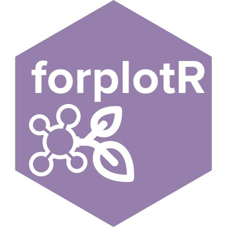

```{=html}
<style>
  body {
    position: relative;
  }

  .watermark {
    position: fixed;
    bottom: 50px;
    right: 50px;
    opacity: 0.15;
    z-index: -1;
    width: 400px;
  }

  .background-overlay {
    position: fixed;
    top: 0;
    left: 0;
    width: 100%;
    height: 100%;
    background-color: rgba(255, 255, 255, 0.8);
    z-index: -1;
  }
</style>
```



## Overview

`forplotR` is an R package that streamlines the workflow linking long-term forest plot censuses to herbarium vouchers. In permanent plots, vouchers are the verifiable evidence that anchors the taxonomic identity of censused stems—supporting robust biodiversity assessments, reliable carbon estimates, and long-term comparability across censuses. Yet, turning raw field tables into curator-ready outputs is often slow, manual, and error-prone.

The package interacts with the [ForestPlots.net standard plot inventory protocol](https://forestplots.net/) by reading standardized field templates and converting specimen records into herbarium-ready outputs, including the JABOT format, BRAHMS format, or any other user-defined structure.

`forplotR` reduces this bottleneck by automating key steps from data validation and voucher tracking to reporting, image organization, interactive mapping, and herbarium exports. By explicitly connecting each physical voucher to its spatial position, taxonomy, and metadata, the package supports the concept of the extended specimen and helps teams maintain a traceable, reproducible link between field inventories and botanical collections.

## Where it fits: ForestPlots.net and Monitora

[ForestPlots.net](https://forestplots.net/) is a collaborative infrastructure for measuring, monitoring, and understanding tropical forests through standardized long-term plot data. Its core data model is a stem-level census table (tags, measurements, identifications, and local x–y coordinates) designed to enable consistent analyses of forest structure, dynamics, and carbon across regions and time.

`forplotR` reads standardized plot templates and turns plot-based specimen records into herbarium-ready outputs, including JABOT, BRAHMS, or any user-defined label structure. It also produces field-facing visual products (PDF reports and interactive maps) that make voucher coverage and plot navigation easier during campaigns and across repeated censuses.

Brazil’s National Biodiversity Monitoring Program (Monitora) generates long-term biodiversity information from protected areas to support management effectiveness and national indicators. In its forest component, vegetation is surveyed using permanent maltese-cross plots (0.4 ha), designed to capture local gradients through four orthogonal arms.

forplotR supports this plot geometry and data structure by converting Monitora stem tables into the same suite of outputs—campaign reports, voucher image folders, interactive maps, and herbarium exports—so teams can iterate efficiently as identifications and voucher coverage improve.

## What forplotR produces

Across protocols, a typical workflow moves from clean census tables → field reports → voucher organization → interactive maps → herbarium exports, helping teams to:

(i) Prepare field campaigns with plot/subplot stem maps and voucher coverage summaries
(ii) Organize voucher media into taxonomically structured directories that update when identifications change
(iii) Explore stems spatially through interactive HTML maps with filters (taxonomy, voucher status, images)
(iv) Export curator-ready spreadsheets for label generation and ingestion into herbarium databases

## Package Description

Package: `forplotR`\
Type: R Package\
Version: 1.0.0

Authors and Maintainers: Giulia Cavalcanti Ottino ([\@DBOSlab](https://github.com/DBOSlab) [ORCID](https://orcid.org/0009-0001-4352-1733)) and Domingos Cardoso ([\@DBOSlab](https://github.com/DBOSlab) [ORCID](https://orcid.org/0000-0001-7072-2656))

### Key features

-   Convert field data into JABOT, BRAHMS, or custom herbarium label formats
-   Create, organize and dynamically update voucher image directories
-   Generate PDF map reports with subplot-level collection summaries
-   Export `.xlsx` files summarizing collection status by subplot
-   Produce interactive HTML map for spatial visualization of the plot, specimen locations and images

## Contribute

You can contribute to `forplotR` by:

-   Opening issues for feedback or bug reports
-   Submitting pull requests for fixes or enhancements
-   Suggesting or developing new features (please open an issue for discussion first)

## License

`forplotR` is [open source software](/LICENSE.md). Open tools empower science through reproducibility, accessibility, and equitable knowledge sharing.

## Acknowledgements

We gratefully acknowledge the financial support provided by [CNPq - Conselho Nacional de Desenvolvimento Científico e Tecnológico](https://www.gov.br/cnpq/pt-br) and [CAPES - Coordenação de Aperfeiçoamento de Pessoal de Nível Superior - Brasil](https://www.gov.br/capes/pt-br) and the institutional supports by the [Rio de Janeiro Botanical Garden](https://www.gov.br/jbrj/pt-br) and [National School of Tropical Botany](https://www.gov.br/jbrj/pt-br/assuntos/educacao/escola-nacional-de-botanica-tropical).
