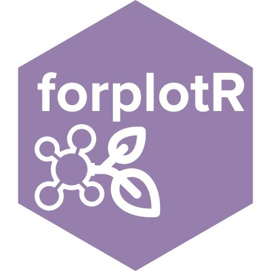

::: {layout-ncol="2"}
::: {style="display: block;"}
### Convert forest plot census data into a herbarium spreadsheet format
- [General use of the `fp_herb_converter()`](/articles/fp_herb_converter_general_usage.qmd)  

::: {style="display: block;"}
:::
### Creates a folder structure for organizing voucher images  
- [General use of the `mk_voucher_dirs()`](/articles/mk_voucher_dirs_general_usage.qmd)

::: {style="display: block;"}
:::
### Generates a full PDF report with plot metadata and map
- [General use of the `plot_for_balance()`](/articles/plot_for_balance_general_usage.qmd)  

::: {style="display: block;"}
:::
### Creates an interactive HTML map of the vouchered forest plot  
- [General use of the `plot_html_map()`](/articles/plot_html_map_general_usage.qmd)
:::
:::
